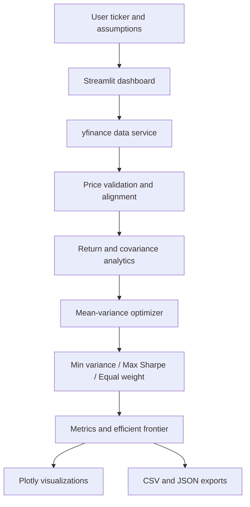

# AI-Based Portfolio Optimization

A modular quantitative-finance application that retrieves historical adjusted prices, estimates annualized returns and covariance, constructs minimum-variance and maximum-Sharpe portfolios, compares them with an equal-weight benchmark, and visualizes the efficient frontier in Streamlit.

## Problem statement and objectives

Portfolio construction requires balancing expected return and risk while accounting for relationships between assets. This project makes the classical mean-variance workflow accessible through a configurable dashboard and transparent Python modules.

Industry relevance includes wealth technology, investment analytics, portfolio research, and risk reporting. This is an educational research tool, not a trading system or investment recommendation.

## Features

- Multiple ticker input and historical adjusted-price retrieval through `yfinance`.
- Price cleaning and common-date alignment.
- Daily simple returns, annualized arithmetic mean returns, and annualized sample covariance.
- Long-only fully invested minimum-variance and maximum-Sharpe optimization.
- Equal-weight benchmark.
- Configurable annual risk-free rate and maximum asset weight.
- Efficient frontier, correlation heatmap, allocation charts, and normalized price chart.
- Downloadable CSV allocations and JSON assumptions/results report.
- Unit tests for core calculations and constraints.

## Technology stack

Python 3.10+, Pandas, NumPy, SciPy, yfinance, Plotly, Streamlit, pytest.

## Architecture



## Folder structure

```text
04_AI_Based_Portfolio_Optimization/
├── app.py
├── requirements.txt
├── README.md
├── LICENSE
├── CONTRIBUTING.md
├── .env.example
├── .gitignore
├── src/portfolio_optimizer/
│   ├── __init__.py
│   ├── data.py
│   ├── analytics.py
│   └── reporting.py
├── tests/
│   ├── test_analytics.py
│   └── test_data.py
├── docs/
│   ├── METHODOLOGY.md
│   └── USER_GUIDE.md
├── data/sample/
├── notebooks/
├── reports/
└── assets/
```

## Mathematical foundations

For asset return vector \(r_t\), sample mean return is annualized as:

\[
\hat{\mu}=252\bar r
\]

The sample covariance is annualized consistently:

\[
\hat{\Sigma}=252\,\mathrm{Cov}(r_t)
\]

For portfolio weights \(w\), expected annual return and variance are:

\[
E[R_p]=w^T\hat{\mu},\qquad
\sigma_p^2=w^T\hat{\Sigma}w
\]

Sharpe ratio with annual risk-free rate \(r_f\):

\[
S_p=\frac{w^T\hat{\mu}-r_f}{\sqrt{w^T\hat{\Sigma}w}}
\]

Minimum variance minimizes \(w^T\hat{\Sigma}w\). Maximum Sharpe maximizes \(S_p\). Both default to \(w_i\geq0\), \(\sum_iw_i=1\), and user-configured upper bounds \(w_i\leq w_{\max}\).

## Data sources and provenance

Market prices are retrieved at runtime from Yahoo Finance through the community `yfinance` Python package. The application uses auto-adjusted prices where returned by the provider. Data availability, ticker coverage, and provider terms can change. No bundled market data or fabricated performance is used.

## Installation

```bash
python -m venv .venv
# Windows:
.venv\\Scripts\\activate
# macOS/Linux:
source .venv/bin/activate

pip install -r requirements.txt
```

## Configuration and execution

No API key is required. Copy `.env.example` to `.env` only if adding optional local configuration later.

```bash
streamlit run app.py
```

Enter at least two tickers (for example `AAPL, MSFT, GOOGL`), choose a lookback and assumptions, then select **Fetch data & optimize**. The dashboard needs an internet connection to retrieve market prices.

## Dashboard usage

- **Overview:** compare minimum variance, maximum Sharpe, and equal-weight portfolios.
- **Efficient frontier:** inspect attainable return/risk combinations under the selected bounds.
- **Risk & diversification:** view daily-return correlations and normalized historical prices.
- **Data:** inspect recent prices and descriptive return statistics.
- Download allocation CSV or the JSON report from the bottom of the page.

## Screenshots

Add screenshots of the running dashboard here after launching locally. No screenshots are included because the dashboard has not been run in this build environment.

## Testing

```bash
pytest -q
```

Tests cover return calculation, covariance symmetry, long-only/budget/upper-weight constraints, optimizer output, efficient frontier generation, and data validation.

## Limitations and assumptions

- Historical mean returns are noisy estimates, not reliable forecasts.
- Arithmetic mean and covariance estimates assume a stationary sample and may change materially with the selected lookback.
- 252 trading days are used for annualization.
- The Sharpe ratio uses the user-entered annual risk-free rate.
- No taxes, dividends beyond adjusted-price treatment, slippage, liquidity constraints, currency conversion, rebalancing, or transaction costs are modeled.
- The equal-weight benchmark is descriptive and may not satisfy a user-set maximum weight below \(1/N\); the UI checks feasibility for optimized portfolios.
- The efficient frontier is numerical and may omit targets for which the solver fails to converge.
- Yahoo Finance availability and usage terms are outside this project's control.

## Future improvements

Add rolling-window estimation, shrinkage covariance, Black-Litterman views, turnover and transaction-cost constraints, walk-forward backtesting, multi-currency handling, and alternative licensed data providers.

## Resume-ready description

**AI-Based Portfolio Optimization | Python, NumPy, Pandas, SciPy, Streamlit, Plotly**
Built an interactive quantitative portfolio analytics platform that retrieves historical market data, computes annualized returns and covariance, optimizes long-only minimum-variance and maximum-Sharpe allocations, compares results with an equal-weight benchmark, and visualizes the efficient frontier with downloadable reports.

## Disclaimer

For education and research only. Not financial advice. Optimization outputs are sensitive to historical inputs and assumptions and do not guarantee future performance.
